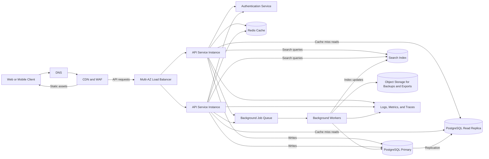

# QuickNotes System Architecture & Scaling Plan

## 1. System Requirements

### Functional Requirements

- Users can register, log in, create, edit, view, search, and delete notes.
- Notes can be categorized using tags.

### Non-Functional Requirements

- High availability: 99.9% uptime.
- Low latency: read API responses under 200 ms.
- Scalability to support 1 million registered users.

## 2. Load & Capacity Estimations

- **User base:** 1,000,000 registered users; 100,000 daily active users (DAU).
- **Reads per second:**
  - Average: `100,000 DAU × 20 views/day ÷ 86,400 seconds/day ≈ 23.1 reads/sec`.
  - Peak (5× average): approximately `115.7 reads/sec`.
- **Writes per second:**
  - Average: `100,000 DAU × 2 notes/day ÷ 86,400 seconds/day ≈ 2.31 writes/sec`.
- **Storage per year:**
  - `100,000 notes/day × 2 KB/note × 365 days ≈ 73 GB/year`.

These are baseline estimates. Production sizing should allow headroom for
traffic bursts, indexes, replicas, backups, and growth in average note size.
The storage estimate assumes 100,000 notes are created each day across the
entire user base.

## 3. System Architecture Diagram

## 4. Component Descriptions

- **DNS:** Resolves application domain names to the CDN's edge entry points.
- **CDN and WAF:** Serves static frontend assets (HTML, CSS, and JavaScript)
  from global edge locations to reduce origin load, and filters common
  malicious traffic. API requests are forwarded to the load balancer.
- **Load balancer:** Runs across multiple availability zones, health-checks
  targets, and distributes incoming HTTP traffic across stateless app servers.
- **App servers:** Run the core API business logic, authenticate and authorize
  requests, validate input, and query the cache or database.
- **Authentication service:** Registers users and issues or validates
  authentication tokens.
- **In-memory cache (Redis):** Caches frequent reads, such as user note lists
  and sessions, to support sub-50 ms cache lookups. Cache keys are scoped by
  user, and mutations invalidate affected keys.
- **Primary database (PostgreSQL):** Accepts writes and executes transactions
  for users, notes, tags, and note-tag associations.
- **Read replica:** Receives replication from the primary and handles eligible
  read traffic to reduce primary database load. Replication lag is considered
  for read-after-write behavior.
- **Message queue and workers:** Process asynchronous tasks, such as sending
  welcome emails and updating the search index, without blocking HTTP request
  cycles. Jobs should be idempotent and retryable.
- **Search index:** Serves full-text search queries; it is updated
  asynchronously by background workers and may briefly lag behind committed
  database changes.
- **Object storage:** Stores generated exports and database backups, subject
  to retention and access-control policies.
- **Observability:** Collects structured logs, metrics, and traces for
  monitoring, alerting, and incident investigation.

## 5. End-to-End Request Flows

### A. `GET /api/v1/notes` flow

1. The client sends an authenticated HTTPS request through DNS and the CDN/WAF
   to the load balancer, which routes it to a healthy app server.
2. The app server validates the request and checks Redis using a cache key
   scoped to the authenticated user and requested page.
3. On a cache hit, the server returns the cached notes.
4. On a cache miss, the server queries the PostgreSQL read replica, stores the
   result in Redis for the configured freshness period, and returns the JSON
   response. Reads requiring read-after-write consistency are routed to the
   primary instead.

### B. `POST /api/v1/notes` flow

1. The client submits an authenticated note payload through the load balancer
   to an app server.
2. The app server validates the payload and writes the note and tag
   associations to the PostgreSQL primary in a transaction.
3. After the write succeeds, the app server invalidates the affected user's
   note-list cache entries in Redis.
4. The app server enqueues a background job to update the search index.
5. The API returns `201 Created` with the created note response.

## 6. Trade-Offs & Single Points of Failure (SPOF)

### Trade-offs

- **Caching complexity vs. speed:** Redis can deliver frequent reads with
  sub-50 ms cache lookup latency, but requires careful per-user cache keys,
  freshness limits, and invalidation after writes.
- **Asynchronous processing vs. instant search visibility:** Queueing search
  index updates keeps indexing work out of the request path, but creates a
  brief delay before a newly created or updated note appears in search.
- **Read replicas vs. consistency:** Replicas reduce read load on the primary,
  but replication lag means recent writes may not be immediately visible on
  replica-served reads.

### Avoiding single points of failure

- Deploy the load balancer across multiple availability zones and run multiple
  stateless app servers behind an auto-scaling group.
- Use a highly available managed PostgreSQL deployment with automated failover.
  Configure and test promotion of a healthy read replica if the primary fails;
  account for replication lag and potential recovery-point implications.
- Use highly available cache and queue configurations where supported, while
  ensuring the database remains the durable source of truth.
- Maintain automated database backups and test restoration and failover
  procedures regularly.

## 7. Scaling and Reliability Plan

### Application tier

- Keep API instances stateless so they can scale horizontally behind the load
  balancer.
- Scale out based on CPU, memory, request concurrency, and latency; configure
  minimum capacity and health checks to handle deployments and instance loss.
- Apply request timeouts, bounded retries with backoff for transient failures,
  and rate limits per user to protect dependencies.

### Database tier

- Start with a managed relational database configured for multi-zone
  availability, automated backups, and point-in-time recovery.
- Index common access patterns, including `notes.user_id`, creation-time
  ordering, and note-tag lookups.
- Use connection pooling and monitor connection saturation, query latency,
  storage growth, and replication lag.
- Add read replicas when measured read load requires them. Route consistency-
  sensitive reads to the primary.
- Revisit partitioning or sharding only when measured database limits justify
  the added operational complexity; if sharding is needed, user ID is a
  candidate partition key.

### Caching and asynchronous work

- Cache only data that can tolerate a defined freshness window. Include the
  authenticated user ID in cache keys and invalidate or update cache entries
  after note and tag mutations.
- Use the background queue for work that is not required to complete a
  synchronous API request. Make jobs idempotent and retryable.

### Availability, security, and recovery

- Target 99.9% monthly availability, tracked with an external availability
  check and API success-rate monitoring.
- Deploy across multiple availability zones and use rolling or canary releases
  with health checks and rollback criteria.
- Require HTTPS, short-lived authenticated access tokens, least-privilege
  service permissions, input validation, and per-user authorization on every
  note operation.
- Encrypt traffic in transit and data at rest; keep secrets in a managed secret
  store and avoid recording tokens or note contents in logs.
- Define and test recovery objectives. Restore backups regularly in a
  non-production environment and document failover procedures.

## 8. Performance Targets and Monitoring

- Measure API latency by endpoint and percentile; target p95 read latency
  below 200 ms under expected peak load.
- Alert on availability, elevated 5xx rates, latency regressions, database
  saturation, queue backlog, and cache health.
- Run load tests against the estimated average and peak traffic, then increase
  capacity with safety headroom based on observed resource use.